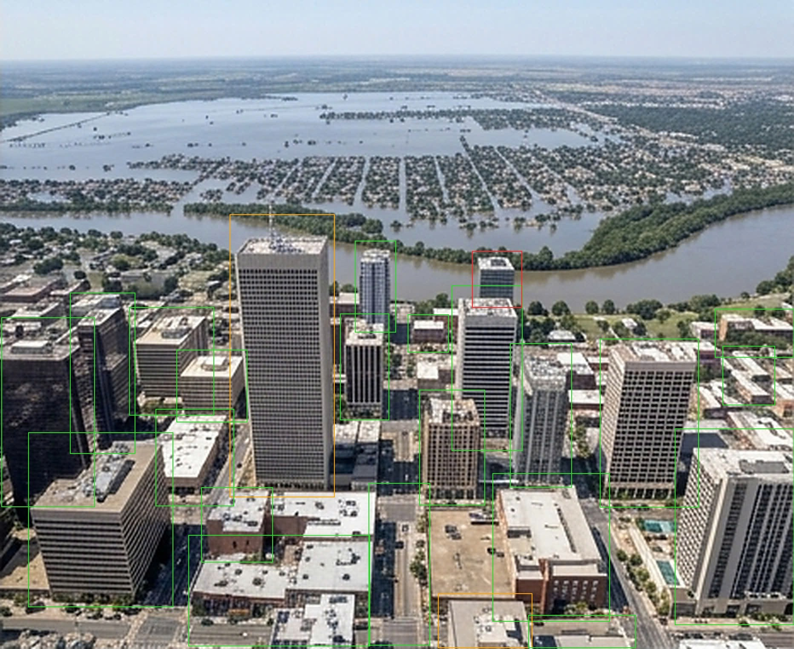

# 항공 촬영 이미지에서 침수 주택 검출 및 계수

[Tiếng Việt](README.md) · [English](README.en.md) · [中文](README.zh.md) · [Français](README.fr.md) · **한국어** · [日本語](README.ja.md)

## 팀

| 이름 | GitHub |
| --- | --- |
| Phùng Duy Hoàng（풍 주이 호앙） | [@21xDHoang](https://github.com/21xDHoang) |
| Bùi Nam Khánh（부이 남 카인） | [@NK-Lync](https://github.com/NK-Lync) |
| Tào Hoàng Minh Vũ（따오 호앙 민 부） | [@aduengxds](https://github.com/aduengxds) |

*괄호 안은 한국어 표기이며, 공식 표기는 베트남어 원표기를 따릅니다.*

2단계 파이프라인입니다. **검출기**가 항공 이미지에서 각 주택의 위치를 찾고, **분류기**가 잘라낸 영역의 상태를 판독한 뒤, 클래스별로 주택 수를 셉니다.

- 검출기: **Cascade R-CNN + ResNet-50-FPN**, 단일 `house` 클래스
- 분류기: **ConvNeXt-Tiny**, `Flooded` / `Not-Flooded` / `Partially-Flooded` 세 클래스
- 웹 앱: **FastAPI**, GPU가 있는 로컬 머신에서 전부 실행

| 항목 | 지표 | 값 |
| --- | --- | --- |
| 검출기(`best_ep4`) | AP50 | 0.631 |
| 분류기 | 종단 간 정확도 | 0.6682 |
| 계수(임계값 0.30) | 4,287개 박스 / 3,441개 정답 박스 | +24.6% |

> 기본 계수 임계값 0.30은 재현율을 우선하므로 총계가 **24.6% 과다 계수**되며, 이미지 단위 오차는 여전히 큽니다(MAE 10.95, p90 18, 최대 49). 이 파이프라인은 대략적인 조사에는 적합하지만 **한 장의 이미지를 정확히 세기에는 부족합니다** — *알려진 한계* 참고.

## 문제 정의

| | |
| --- | --- |
| 입력 | 640×640 항공 이미지 한 장 |
| 출력 | 주택마다 하나의 박스와 세 가지 상태 중 하나, 그리고 클래스별 계수 표 |

주요 난점은 주택이 매우 작고, 물이 탁하며, `Flooded`와 `Partially-Flooded` 레이블 경계가 모호하고, 이미지가 완전히 비어 있거나 매우 빽빽할 수 있다는 점입니다.

## 데이터

출처 Roboflow, 640×640 이미지, 세 클래스 `Flooded`, `Not-Flooded`, `Partially-Flooded`. 총 **2,778장 · 44,967개 박스**이며, 분할은 Roboflow에서 받은 그대로 사용하고 테스트 세트는 보고 시점에 한 번만 사용합니다.

| 속성 | 값 |
| --- | --- |
| 데이터셋 | [`merged_dataset` – v1](https://universe.roboflow.com/housedetectionclassification-jugwz/merged_dataset-dk0ch) |
| 라이선스 | **CC BY 4.0** — 재사용 시 출처 표기 필수 |
| 레이블 형식 | COCO |
| Roboflow 전처리 | 자동 방향 정렬(EXIF 제거), 640×640 늘리기 리사이즈, 증강 없음 |
| 내보낸 날짜 | 2024-11-07 |

| 분할 | 이미지 | 박스 | 비고 |
| --- | --- | --- | --- |
| Train | 2,116 | 33,145 | 32 px 미만 박스 10.7%, 64 px 미만 48.5% |
| Valid | 459 | 8,381 | 모델과 임계값 선택에 사용 |
| Test | 203 | 3,441 | 12장은 주택이 없음 |

전체 통계: `nha_ngap_v002_code/nha_ngap_v002_code/huan_luyen/01_thong_ke_du_lieu.txt`.

## 아키텍처

두 모델은 서로 다른 일을 배웁니다. 검출기는 "주택이 어디에 있는가"만, 분류기는 "상태가 무엇인가"만 답합니다. 추론 시 크롭은 검출기 박스에서 얻으며 정답 레이블은 사용하지 않습니다.

**검출기** — Cascade R-CNN, ResNet-50-FPN 백본, IoU 0.5 / 0.6 / 0.7의 3단계, `house` 클래스 + 배경(2 logit), 앵커 32–512 px(stride 4–64 × scale 8), `keep_ratio` 리사이즈 파이프라인 1333×800, `RandomResize` 없음. 설정: `huan_luyen/cau_hinh_detector.py`.

**분류기** — ConvNeXt-Tiny(ImageNet-1K V1), 27.82 M 파라미터, 출력 768 → 3클래스, 입력 224 px, 학습과 추론 모두 15% 크롭 여백, 12 epoch, AdamW 3e-4, label smoothing 0.05.

기본 파이프라인: 이미지 → 검출기 → score ≥ 0.30, 최대 100개 박스 → 크롭(+15%) → ConvNeXt-Tiny → 클래스별 계수.

## 재학습

두 노트북 모두 Colab(T4로 충분)에서 실행하며, 열고 *Run all*을 위에서 아래로 누르면 됩니다:

- `nha_ngap_v002_code/nha_ngap_v002_code/huan_luyen/Colab_NhaNgap_v002_Aug.ipynb` — 증강 버전, 현재 사용하는 `best_ep4`를 생성
- `nha_ngap_v002_code/nha_ngap_v002_code/huan_luyen/Colab_NhaNgap_v002.ipynb` — 증강 없는 버전, epoch 20 수치는 `02_ket_qua_detector.txt`에 있음

| 셀 | 내용 |
| --- | --- |
| 1–3 | 환경 점검, `mmcv` / `mmengine` / `mmdet` 설치, CUDA 연산이 실제로 동작하는지 확인 |
| 4–5 | 데이터 확보, 통계 산출, 두 형식으로 변환: 검출기용 단일 `house` 클래스와 분류기용 원래 세 클래스 |
| 6–7 | Cascade R-CNN 검출기 학습, 학습 곡선 시각화, 테스트에서 mAP 평가 |
| 8 | 실제 박스에서 크롭한 샘플로 ConvNeXt-Tiny 분류기 학습 |
| 9–10 | 203장에 대해 검출 → 분류 → 계수 실행, 요약 및 결과 파일 4개 기록 |
| 11 | Gradio 웹 데모 |

체크포인트는 검증 mAP 기준 `save_best`로 저장되므로 `best_ep4`는 **4번째 epoch**이며 마지막 epoch가 아닙니다. 증강 없는 버전의 `epoch_20`과 혼동하지 마십시오.

## 결과



*이미지는 웹 앱이 직접 내보낸 것입니다(`export/mau_ket_qua.jpg`). 박스 색상은 `loi_suy_luan.py`를 따릅니다: 빨강 = `Flooded`, 주황 = `Partially-Flooded`, 초록 = `Not-Flooded`.*

### 검출기

두 체크포인트의 결과가 있으니 **수치를 섞지 마십시오**:

| 체크포인트 | AP | AP50 | AP75 | AP_s | 출처 |
| --- | --- | --- | --- | --- | --- |
| `best_ep4`(웹 앱 기본값) | 0.313 | 0.631 | 0.284 | 0.169 | 보고서에 제시된 수치 |
| epoch_20(증강 없음) | 0.277 | 0.584 | 0.233 | 0.149 | `02_ket_qua_detector.txt` |

AP_s가 낮은 것은 실제 한계입니다. RPN의 최소 앵커가 32 px(stride 4 × scale 8)이고 학습이 단일 리사이즈 파이프라인만 사용하므로, 수십 픽셀 크기의 주택에는 잘 맞는 앵커가 없습니다.

### 분류기

검증 세트 8,381개 크롭에서 **정확도 0.7195**. 테스트 크롭(정답)에서는 0.6713. 검출기 박스를 사용하면 **종단 간 0.6682**로 거의 떨어지지 않으며, 이는 검출기 크롭이 병목이 아니라는 뜻입니다.

| 실제 \ 예측 | Flooded | Not-Flooded | Partially-Flooded | 재현율 |
| --- | --- | --- | --- | --- |
| Flooded | 1,514 | 115 | 606 | 67.7% |
| Not-Flooded | 55 | 2,696 | 608 | 80.3% |
| Partially-Flooded | 440 | 527 | 1,820 | 65.3% |

오차는 `Flooded` ↔ `Partially-Flooded` 쌍(606 + 440)에 집중됩니다. 분류기에는 **배경 클래스가 없어서**, 검출기의 잡음 박스도 세 클래스 중 하나로 강제 분류됩니다.

### 계수

| 체크포인트 | 계수 박스 @ 0.30 | 정답 | 차이 | MAE / 주택이 있는 이미지 |
| --- | --- | --- | --- | --- |
| `best_ep4` | 4,287 | 3,441 | +846(+24.6%) | 10.95(p90 18, 최대 49) |
| epoch_20 | 3,414 | 3,441 | −27(−0.8%) | 9.47 |

epoch_20의 총계는 정답과 거의 맞지만 이는 **오차 상쇄**입니다. 어떤 이미지는 과다 계수되고 다른 이미지는 과소 계수되어 이미지 단위 MAE는 여전히 10에 가깝습니다. 따라서 총계만 따로 읽어서는 안 됩니다.

## 지표 정의

| 지표 | 정의 / 범위 |
| --- | --- |
| AP | COCO bbox, IoU 0.50 : 0.05 : 0.95 구간 평균 |
| AP50 / AP75 | IoU 0.50 / 0.75 |
| AP_s / AP_m / AP_l | 면적 < 32² / 32²–96² / > 96² px² 인 박스 |
| 정확도(분류기) | 정답 수 / 전체, 검증 세트 8,381개 크롭에서 측정 |
| 종단 간 | 검출기 박스에 분류기를 적용, 해당 박스가 정답과 IoU 0.5로 매칭됨 |
| MAE | 주택이 있는 이미지에서 \|계수 − 정답|의 평균 |

AP는 `score_thr` 0.05에서 측정하고 계수는 0.30 임계값을 사용합니다. 두 값은 스케일이 다르므로 AP와 정확도를 직접 비교하면 안 됩니다.

## 검증

웹 앱 자체 코드(`best_ep4`, 임계값 0.30)로 203장을 다시 실행하면 4,288개 박스가 나와, 4,287 대비 **+1개(0.023%)** 차이가 납니다. `Flooded` 클래스는 890/890으로 정확히 일치하며, 차이는 Colab(Tesla T4)과 웹 머신(RTX 2050) 간 OpenCV 및 GPU 아키텍처 차이에서 비롯됩니다. 4,287 기준값은 이 검증을 재현할 수 있도록 `kiem_tra_moi_truong.py`에 `MOC_4287`로 하드코딩되어 있습니다.

자세한 내용: `nha_ngap_web/nha_ngap_web/KET_LUAN_KIEM_CHUNG.txt`.

## 저장소 내 문서

| 파일 | 내용 |
| --- | --- |
| [`HUONG_DAN_CHO_BAN.txt`](nha_ngap_web/nha_ngap_web/HUONG_DAN_CHO_BAN.txt) | 설치와 실행 전체 안내, 자주 나는 오류 표 포함 |
| [`KET_LUAN_KIEM_CHUNG.txt`](nha_ngap_web/nha_ngap_web/KET_LUAN_KIEM_CHUNG.txt) | 4,287 박스 검증 기록과 +1 차이에 대한 설명 |
| [`01_thong_ke_du_lieu.txt`](nha_ngap_v002_code/nha_ngap_v002_code/huan_luyen/01_thong_ke_du_lieu.txt) | 2,778장 · 44,967개 박스의 분할별 통계 |
| [`02_ket_qua_detector.txt`](nha_ngap_v002_code/nha_ngap_v002_code/huan_luyen/02_ket_qua_detector.txt) | epoch_20 체크포인트의 지표별 AP |
| [`03_ket_qua_classifier.txt`](nha_ngap_v002_code/nha_ngap_v002_code/huan_luyen/03_ket_qua_classifier.txt) | 분류기 혼동 행렬과 정확도 |
| [`04_dem_nha_test.txt`](nha_ngap_v002_code/nha_ngap_v002_code/huan_luyen/04_dem_nha_test.txt) | epoch_20 체크포인트의 클래스별 계수 표 |

## 디렉터리 구조

```
.
├── export/                              # 앱이 내보낸 결과: png/, jpg/, csv/
├── nha_ngap_v002_code/nha_ngap_v002_code/
│   ├── huan_luyen/                      # Colab 노트북, 검출기 설정, 결과 파일 4개
│   └── web/                             # 이전 웹 사본, 비교용으로 보관
└── nha_ngap_web/nha_ngap_web/           # 주 애플리케이션
    ├── ung_dung.py                      # FastAPI: 화면과 모델 수명 주기
    ├── loi_suy_luan.py                  # 순수 추론, 웹과 무관
    ├── kiem_tra_moi_truong.py           # 5단계 환경 점검, --dem-test 플래그
    ├── giao_dien/index.html
    ├── checkpoints/                     # cau_hinh_detector.py(포함); .pth 2개는 직접 추가
    └── test/                            # 테스트 이미지 203장
```

## 설치 및 실행

### 요구 사항

| 항목 | 값 |
| --- | --- |
| 운영체제 | Windows 10/11 64비트 |
| Python | **3.13 64비트**, python.org에서 설치 — Microsoft Store 버전 사용 금지, 3.12와 3.14는 `mmcv` 설치 불가 |
| GPU | NVIDIA, RTX 2050 4 GB에서 검증됨 |
| 드라이버 | R580 이상(CUDA 13.2) |
| 디스크 | 약 6–7 GB, 첫 설치 시 약 2.5 GB 다운로드 |
| 경로 | ASCII, 악센트와 공백 없음 |

### 체크포인트

저장소에는 `.pth` 파일이 **포함되지 않습니다**(`.gitignore`가 `**/*.pth` 제외). 다음 세 파일이 `nha_ngap_web/nha_ngap_web/checkpoints/` 아래에 모두 있어야 합니다:

```
work_det/cau_hinh_detector.py                     저장소에 이미 포함
work_det/work_aug/best_coco_bbox_mAP_epoch_4.pth  직접 추가
work_cls/convnext_tiny_3lop.pth                   직접 추가
```

셋 중 하나라도 없으면 웹 앱이 실행되지 않습니다. `.pth` 두 개는 학습한 머신 또는 팀 드라이브(`nha_ngap_v002_out/`)에서 가져옵니다.

### 실행 단계

```bat
cd nha_ngap_web\nha_ngap_web

:: venv 생성 및 약 2.5 GB 다운로드, 10-30분 소요
CAI_DAT.bat

:: 5단계를 모두 통과해야 함
venv\Scripts\python.exe kiem_tra_moi_truong.py

:: http://127.0.0.1:8000 열림
CHAY_WEB.bat
```

8000 포트가 사용 중이면 `CHAY_WEB.bat --cong 8080`을 사용하십시오.

보고서의 계수 수치를 재현하려면(2–3분, 약 4,287개 박스가 나와야 함):

```bat
venv\Scripts\python.exe kiem_tra_moi_truong.py --dem-test
```

웹 앱에는 네 개의 엔드포인트가 있습니다: `GET /`, `GET /api/thong_tin`, `POST /api/du_doan`, `POST /api/export`(PNG/JPG/CSV를 `export/`에 저장). 모델은 시작 시 한 번만 로드되며, `mmdet`이 스레드 안전하지 않고 GPU가 4 GB뿐이므로 요청은 병렬이 아니라 대기열로 처리됩니다.

## 알려진 한계

- **테스트 세트가 작고 출처가 하나** — 203장, 외부 테스트 없음.
- **레이블 모호성** — `Flooded`와 `Partially-Flooded`가 분류기 오차의 대부분을 차지.
- **분할에 출처 중복이 남아 있음** — MD5 그룹 7개, 기본 파일명 49개, 영상 그룹 3개. 중복 제거와 출처 기준 분할이 필요.
- **총계가 맞다고 이미지별로 맞는 것은 아님** — MAE 10.95, p90 18, 최대 49.
- **배경 클래스 부재** — 잡음 박스가 세 클래스 중 하나로 분류되어 과다 계수를 유발.
- **임계값 미최적화** — 점수가 보정되지 않았고, 임계값을 올리는 것은 정밀도/재현율을 맞바꿀 뿐 원인을 고치지 못함.
- **작은 주택** — 최소 앵커와 단일 스케일 학습 때문에 AP_s가 낮음.
- **프로덕션에는 부적합** — 실제 계수 전에 배경 클래스, 캘리브레이션, 깨끗한 분할이 필요.

## 개선 방향

| 우선순위 | 작업 | 이유 |
| --- | --- | --- |
| P0 | 분류기에 배경/거부 클래스 추가 | 잡음 박스가 현재 주택으로 분류됨 — 과다 계수의 최대 원인 |
| P0 | 검증 세트에서 점수 캘리브레이션 | 현재 0.30 임계값은 확률적 의미가 없음 |
| P1 | F1 대신 계수 MAE 기준으로 임계값 선택 | 목표가 검출이 아니라 계수이므로 |
| P1 | 작은 주택용 앵커 / 타일링 / 랜덤 스케일 | AP_s가 0.169에 그침 |
| P2 | 중복 제거 및 출처 기준 분할 | 테스트가 깨끗해야 수치를 완전히 신뢰 가능 |
| P2 | `max_per_img`를 150–200으로 상향 | 203장 중 2장이 100개 상한에 걸림 |

## 라이선스

- **소스 코드**: MIT — [`LICENSE`](LICENSE) 참고.
- **데이터**: Roboflow의 `merged_dataset` v1, CC BY 4.0 — 재사용 시 출처 표기 필수.

---

*[README.md](README.md)에서 번역했습니다. 수치가 다를 경우 베트남어 원본이 기준입니다.*
